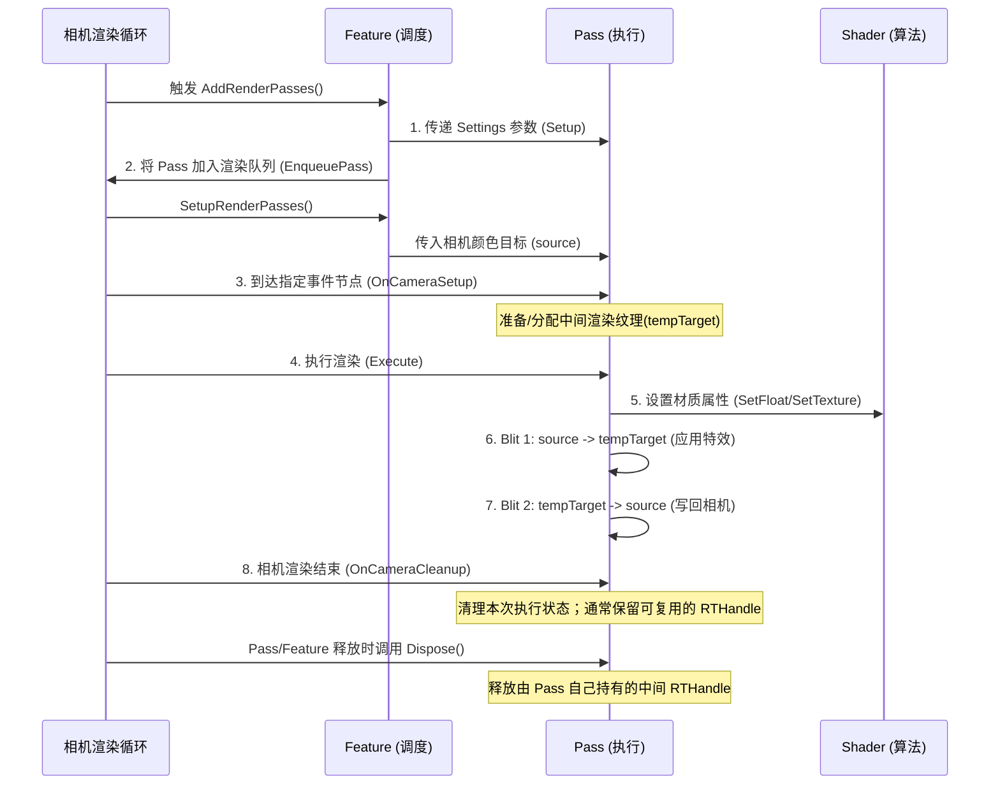

# Unity URP 屏幕后处理框架指南

## 一、核心架构与内在联系

URP 后处理框架的本质是**职责分离**，四大核心文件各司其职，通过数据流串联。

```text
┌────────────────────────────────────────────────────────────────────────┐
│ 1. Feature (调度层)                                                     │
│ 继承: ScriptableRendererFeature                                         │
│ 作用: 读取 Settings 参数 -> 创建 Material -> 向管线注册 Pass                │
│ 配置: 挂载在 URP-HighFidelity-Renderer 资产上                             │
└───────────────────┬────────────────────────────────────────────────────┘
                    │ (1) 每帧传递参数 EnqueuePass
                    ▼
┌────────────────────────────────────────────────────────────────────────┐
│ 2. Pass (执行层)                                                        │
│ 继承: ScriptableRenderPass                                              │
│ 作用: 申请临时 RT -> 将参数写入 Material -> 执行两次 Blit                    │
│ 配置: 指定 RenderPassEvent (如 BeforeRenderingPostProcessing)            │
└───────────────────┬────────────────────────────────────────────────────┘
                    │ (2) 调用 Blitter.BlitCameraTexture
                    ▼
┌────────────────────────────────────────────────────────────────────────┐
│ 3. Shader (算法层)                                                      │
│ 语言: HLSLPROGRAM                                                       │
│ 作用: 采样 _BlitTexture，执行具体的像素级数学运算 (如模糊、调色)                │
│ 配置: 包含 Blit.hlsl，白嫖全屏顶点着色器                                    │
└────────────────────────────────────────────────────────────────────────┘

※ 贯穿全局：4. URPPostEffectsBase (工具层) -> 静态类，负责 Material 的安全创建与销毁。
```

---

## 二、渲染执行流程图

在每一帧的渲染过程中，数据是如何流转的？



---

## 三、项目挂载实战

项目使用哪个 Renderer 资产，应以当前 URP Asset 的 Renderer 配置为准。

| 步骤 | 操作动作 | 关键位置/对象 | 说明 |
| :--- | :--- | :--- | :--- |
| **1. 找对文件** | 在 Project 搜索 | 项目实际使用的 Renderer 资产 | 文件名可能带 `-Renderer`，但应以 URP Asset 当前选用的 Renderer 为准。 |
| **2. 添加组件** | 点击 `Add Renderer Feature` | Renderer 资产的 Inspector 底部 | 选择你编译好的 `CustomPostProcessFeature`。 |
| **3. 拖入依赖** | 挂载 Shader | Feature 的 Settings 面板 | 将 `CustomPostProcess.shader` 拖入 Shader 槽位。 |

---

## 四、多效果扩展逻辑

**入门阶段：一种效果一套独立 Shader / Pass / Feature”的组织方式。**

如果你已经有了【效果 A】，现在要加【效果 B】，可以先复制一套文件再修改，便于隔离参数和逻辑。多个效果也可以共享 Pass 或统一调度，取决于项目架构：

```text
已有文件集 (效果 A)                  新建文件集 (效果 B)
--------------------                --------------------
1. Grayscale.shader    ──(复制改算法)──> 1. Invert.shader
2. GrayscalePass.cs    ──(复制改类名)──> 2. InvertPass.cs
   (检查 RT 资源的所有权与生命周期)
3. GrayscaleFeature.cs ──(复制改类名)──> 3. InvertFeature.cs
                                         │
                                         ▼
                              按项目架构添加或注册效果
```

**新增效果修改清单**
1. Shader: 文件名、Shader 路径名、参数表、算法
2. Pass: 文件名、Pass 类名、参数定义、SetFloat/SetVector/SetTexture 传值
、中间 RT 的调试名称，例如 `"_TempXXXTarget"`
3. Feature: 文件名、Feature 类名、Settings 参数表、Setup 传参及其 Pass 字段
4. Renderer Data: Feature 添加、Shader 指定

---

## 五、 核心代码防坑清单

框架代码较多，但真正决定**能否跑通**和**是否报错**的往往是以下几个细节：

| 模块 | 防坑代码/原则 | 原因 |
| :--- | :--- | :--- |
| **Shader** | `#include "...Blit.hlsl"` | 配合 `Blitter.BlitCameraTexture()` 时，通常从 `_BlitTexture` 读取输入；具体以项目使用的 URP/Core RP 包为准。 |
| **Feature** | 相机类型过滤 | Preview 相机通常可以过滤；是否过滤以及过滤哪些相机，按项目需求决定。 |
| **Pass** | `descriptor.depthBufferBits = 0;` | 常见全屏颜色中间目标通常不需要深度；若项目有特殊需求，应结合管线配置确认。 |
| **Pass** | 两步 Blit 法 | `source` ➡ `temp` (加特效) ➡ `source` (覆写)。**不能**直接带材质写入 `source`。 |
| **Pass** | RTHandle 生命周期 | 可复用的中间 RTHandle 通常由 Pass 持有，并在 `Dispose()` 中释放；`OnCameraCleanup` 不代表必须释放所有长期资源。 |

---

## 六、 文件职能速查表

| 角色 | 文件命名习惯 | 核心技术点 | 修改频次 |
| :--- | :--- | :--- | :--- |
| **算法核心** | `XXX.shader` | 采样、UV、数学运算 | ⭐⭐⭐⭐⭐ 高 |
| **参数搬运** | `XXXPass.cs` | 两步 Blit、参数传值 | ⭐⭐⭐ 中 |
| **调度控制** | `XXXFeature.cs` | 创建材质、生命周期管理 | ⭐⭐ 低 |
| **基建打底** | `URPPostEffectsBase.cs` | 静态工具类 | ⭐ 极低（写一次就行） |